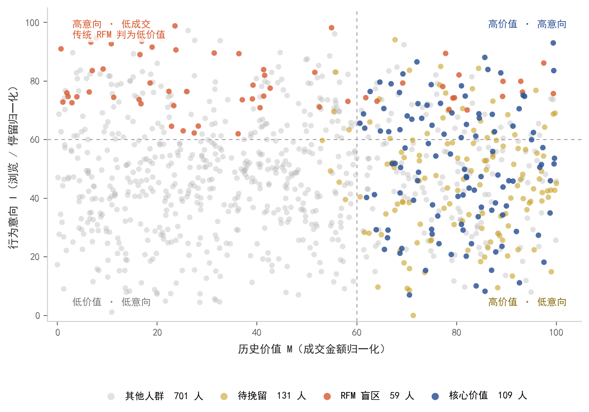
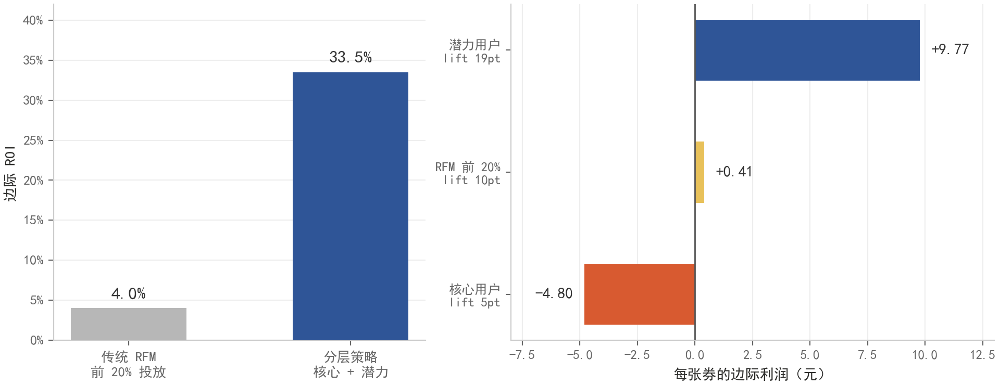

# 电商用户价值分层与精准营销策略

> 用站内行为数据补上传统 RFM 的盲区，并把「该给谁发券」算成一笔账。

传统 RFM（Recency / Frequency / Monetary）的三个指标全部来自**已经发生的交易**。这带来一个结构性缺陷：
一个在站内逛了两小时、翻了 30 个页面却始终没下单的用户，R、F、M 三项全低，会被直接判为「低价值用户」，永远不会收到一张优惠券。

但营销预算的边际收益恰恰在这类人身上最高——核心用户**本来就会买**，给他发券只是把「本来要花的钱」变成「打折花的钱」。

本项目在 RFM 上补入两个行为维度，把「逛得多 ≠ 买得多」这件事量化，并测算差异化投放的增量 ROI。

| 指标 | 结果 |
|---|---|
| 分层策略边际 ROI | **33.5%**（传统 RFM 前 20% 投放为 4.0%） |
| 单位预算增量效率 | **8.3 倍**，成本同时下降 20.5% |
| 传统 RFM 覆盖不到的高意向人群 | **59 人** |
| 人群分层 | 15 类，收敛为 4 组动作对象 |

---

## 一、问题定义

浏览页数、停留时长与购买频次的相关系数分别是 **0.026** 与 **-0.028**，基本等于 0。

这个结果乍看是坏消息，实际是整个项目的立论基础：**如果三者强正相关，说明「逛得多就买得多」，那按消费金额排序就够了，根本不需要新指标。**
接近 0 恰恰说明行为强度不能代理购买强度——中间被某个环节截断了。把这个环节单独量化出来，就是后面的「决策摩擦」。

支持这个判断的另外两个数据点：

- 高摩擦用户（前 25%）平均浏览 **34.3 页**，却只购买 **1.6 次**，消费 2,514 元——他们不是不花钱，是决策慢。
- 高收入但消费低于中位数的有 **184 人**，占高收入群体的 **54.1%**——一半高收入用户没有被转化。



> 1,000 名用户在「历史价值 M × 行为意向 I」平面上的位置。左上角橙色区域是传统 RFM 的盲区：意向高、成交少。
> 虚线为 60 分位分割线。

---

## 二、方法

```
数据质检 → 特征工程 → RFM-I 打分 → 人群分层 → ROI 测算
```

### 三个自建指标

| 指标 | 定义 | 业务含义 |
|---|---|---|
| **I** 意向深度 | `0.5 × 时长归一 + 0.5 × 页数归一`（0–100） | 两个都取、等权合成：只看时长会被「页面挂着人走了」骗，只看页数会被「反复刷同一页」骗 |
| **Friction** 决策摩擦 | `浏览页数 / (购买频次 + 1)` | 平均看多少页才换来一次成交。分母 +1 让零购买用户不除零，同时使「0 次购买」退化为浏览页数本身，保持单调可比 |
| **L** 活跃连接度 | 订阅 + 近 7 日登录 → 3 / 2 / 1 | 衡量的不是忠诚，而是**触达成本**：订阅且最近来过，一条推送就能触达 |

### 关键设计：意向分当乘数，不当加数

```
RFM_Score   = 0.2 × R + 0.3 × F + 0.5 × M      # M 权重最高，R 的信息已被 F 部分吸收
Final_Score = RFM_Score × (1 + I / 500)        # I 最大贡献 +20%，有上界
```

如果改成加权平均（比如 I 占 0.2 权重），意向分会变成「第四个分数」，被前三项的量纲稀释——
历史成交为 0 的用户，前三项加起来就是 0，第四项再高也浮不上来。

乘数的语义是**修正**而不是替代：它保证高意向低成交的人能上浮，但**永远不超过核心 VIP**。
业务上的说法是——意向是价值的放大器，不是价值本身。

### 分层规则

8 条基础规则（基于 R/F/M 相对 40、60 两个阈值的组合）+ 6 条业务修正规则，输出 15 类人群。
修正规则的例子：

- 高收入 + 高意向 + 被基础层判成低价值 → `高潜沉睡用户`
- 高收入 + I>70 + F<40 + M<50 → `纠结土豪`
- 高收入 + R<40 + M>50 → `高潜流失客`（曾经的大客户正在流失）
- 低收入 + I>70 + F<40 → `隐形活跃者`

---

## 三、结果

三个人群的真实记录（非虚构画像）：

| 用户 | 画像 | 数据 | 动作 |
|---|---|---|---|
| `#140` | 纠结土豪 | 收入 14.4 万，停留 **446 分钟**、浏览 **35 页**，购买 **0 次**，消费 255 元 | 逛了七个多小时一单没成，最该发首单券 |
| `#388` | 高潜流失客 | 收入 14.6 万，累计消费 **4,674 元**、买过 **9 次**，但已 **21 天未登录** | 召回优先级最高 |
| `#48` | 核心 VIP | 收入 14.3 万，购买 8 次、5 天前登录，停留 585 分钟 | 不需要券，需要专属权益 |

核心 VIP 23 人（2.3%，人均消费 4,171 元、购买 8.2 次）；高潜流失客 64 人（6.4%，人均收入 12.2 万元但已停止复购）。

---

## 四、一个反直觉的发现

ROI 测算用的是**边际**口径而不是总额：分子分母都只取增量。

```
增量收益 = 目标人数 × 增量转化率(lift) × 客单价 − 目标人数 × 券成本
```

| 方案 | 目标人数 | 平均 lift | 成本 | 增量收益 | 边际 ROI |
|---|---|---|---|---|---|
| 传统 RFM 前 20% | 200 | 10 pt | 2,000 元 | 2,081 元 | **4.0%** |
| 分层策略（核心 + 潜力） | 159 | — | 1,590 元 | 2,123 元 | **33.5%** |

券成本 10 元、客单价 104 元，对应的**盈亏平衡 lift 是 9.61%**——低于这条线，发券就是亏的：



- 核心用户 lift 5pt < 9.61% → 每张券**净亏 4.80 元**
- 传统 RFM 前 20% lift 10pt ≈ 9.61% → 每张券净赚 0.40 元（勉强打平，所以 ROI 只有 4%）
- 潜力用户 lift 19pt > 9.61% → 每张券**净赚 9.77 元**

把方案 B 拆开看：**核心用户那 70 张券净亏 336 元，全靠潜力用户赚的 869 元填回来。**

也就是说，「80% 预算保核心」这个设计是**反的**——核心用户本来就会买，券只是纯补贴，
该给的是专属权益、优先购这类零边际成本的东西；券应该集中投给 lift 高于 9.61% 的潜力人群。

---

## 五、局限

这个结论只到方法论层面，往下不能推：

1. **样本**：1,000 条合成数据，分布接近均匀（Top 20% 用户只贡献 35.3% 消费，**不符合真实电商的二八结构**）。分层比例的**方向**可参考，绝对金额不能当业务预测。
2. **字段**：85 条记录「购买 0 次却有消费额」，业务上不成立；停留时长中位数 292 分钟、最长 10 小时，量级脱离常识。因此金额与时长的解读只做**相对排序**。
3. **指标**：兴趣偏好与品类偏好字段匹配率 0%，是两个不同的标签体系，已主动剔除以避免噪声入模——这意味着「人货匹配」这条线索本项目没有验证。
4. **模型**：手写阈值对「各项都中等」的中间地带没有判定能力，**44.3% 的用户落进「一般用户」兜底类**。改进方向是分位数打分（RFM 各 5 档共 125 格）或 K-means 聚类，用轮廓系数选 k。
5. **ROI**：转化率 lift 是**假设参数**，不是 A/B 实验测出来的。结论的结构不依赖具体取值，但 33.5% 需要真实实验校准。

### 下一步

- 把 lift 从 5% 扫到 25% 做敏感性分析，标出与传统方案打平的临界点
- 用 K-means 对比规则分层，轮廓系数 + 业务可解释性双重选型
- 用 `Last_Login_Days_Ago` 定义流失标签跑逻辑回归，验证自建的 Friction 指标确实有解释力

---

## 目录结构

```
.
├── data/
│   └── user_personalized_features.csv   # 原始数据（1,000 × 14）
├── src/
│   ├── rfm_run.py                       # 主流程：质检 → 特征 → 打分 → 分层 → ROI
│   └── make_charts.py                   # 生成 README 引用的两张图
├── docs/                                # 图表
├── outputs/                             # 运行产物（已 gitignore）
└── requirements.txt
```

## 运行

```bash
pip install -r requirements.txt
python src/rfm_run.py
```

脚本会把 5 张图和人群明细 CSV 输出到 `outputs/`。

**环境**：Python 3.12 / pandas 3.0 / numpy 2.4 / matplotlib 3.10。
脚本内使用 `matplotlib.use('Agg')`，无图形界面环境也能跑；顶部 `SHOW_PLOTS = True` 可改为逐张弹窗查看。

## 数据来源

Kaggle 公开数据集 `user_personalized_features.csv`（1,000 行 × 14 列，含人口属性、交易记录、站内行为三类字段）。
清洗时剔除 1 列无名索引，未做样本删减。仅用于方法演示。
